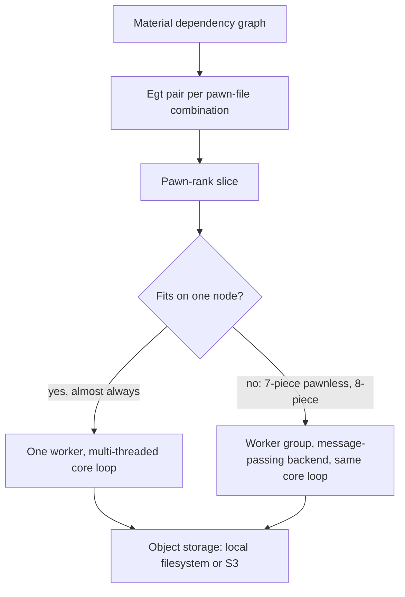

# Scaling and Parallelization: Design and Roadmap

This document reviews the key design choices of `chess-egt` in view of generating
6-piece tablebases and beyond. It compares two ways to parallelize:
shared-memory multi-threading and a swarm of message-passing workers with
separate memory. It ends with a proposed implementation roadmap.

It builds on [`algorithms_comparison.md`](algorithms_comparison.md), in
particular the single-threaded measurements of the counters and sweep core
loops in its Section 2.A.

**Status:** Steps 1-4, the object-storage prerequisite of Step 5, and the local
per-position optimizations in Step 6 are implemented. The job runner in Step 5
and distributed backend in Step 7 remain proposals.

---

## 1. Summary

- **6-piece tables do not need distributed memory.** The largest 6-piece
  table pair (both sides-to-move of one `Egt` pair) takes ~25 GB at 2 bytes per
  position. The bottleneck is compute (~10⁴ core-hours at the current cost per
  position), not memory. Independent jobs, each multi-threaded on one machine,
  are enough.
- **7-piece tables need distributed memory only for a minority of cases.**
  Pawnless tables and one-pawn tables without rank slicing need ~1.2-1.4 TB
  per pair. Pawnful tables split into small independent slices. 8-piece
  tables need distributed memory everywhere.
- **The implemented core loop is a hybrid:** **decremental counters driven by per-ply table scans**
  (no queues). It has the counters' low work per retrograde edge and the
  sweep's zero extra memory. Its updates are pushed to the position being
  updated and never require reading remote data. It therefore runs unchanged on
  shared memory (atomic updates) and on separate-memory workers (messages).
- **Next scaling step:** schedule independent jobs around the existing
  multi-threaded solver before introducing a worker swarm.
- **At 7 pieces, the cost per position dominates everything.** A 5x faster core
  loop saves more than any parallelization design.
- **Cloud cost (speculative, Section 9):** all 6-piece tables take about one day
  on ~10 large AWS instances for $500-900 on-demand. All 7-piece tables take
  3-5 weeks on ~50 instances for roughly $300k on-demand ($60k-150k on spot),
  plus ~$2k/month to keep them on S3 Standard.

---

## 2. Scale of the problem

### 2.1 Memory

Positions per side-to-move under the current indexing, for the worst case where
all non-king pieces are distinct. Memory is for one table pair (both sides) at
2 bytes per position:

| Pieces | Pawnless pair | 1-pawn `Egt` pair (fixed file) | Same, one pawn-rank slice |
|---|---|---|---|
| 5 | 0.42 GB | 0.34 GB | 57 MB |
| 6 | **24.7 GB** | 20.2 GB | 3.4 GB |
| 7 | **1.43 TB** | 1.17 TB | 195 GB |
| 8 | 82 TB | 67 TB | 11 TB |

How the numbers are computed:
- Pawnless: 462 king pairs times `62 * 61 * ...` for the other pieces.
- 1-pawn: 6 pawn squares times `63 * 62 * ...` for the other pieces.
- Rank slice: the 1-pawn value divided by the 6 pawn ranks.
- Tables with repeated pieces are smaller (divide by `k!`). Multi-pawn tables
  add small en passant sub-tables.

These values match the measurements. For example, the sweep's peak RSS of
~500 MiB on `KQB_KQ` is essentially the 0.42 GB of tables, while the counters'
queues peak at 3.5-8.4 GiB on shallow 5-piece tables.

A relevant detail: a 6-piece pawnless table has 6.2 × 10⁹ positions per side,
which is more than `u32::MAX`. Storing indices as `u32` (a TODO in `AGENTS.md`)
therefore only works for indices relative to a chunk, not for local `Egt`
indices.

### 2.2 Compute

- 5-piece generation took 26 h for 2.6 × 10¹⁰ positions, i.e. ~3.6 µs per
  position, single-threaded.
- From 4 to 5 pieces, the number of positions grew ~200x and the time ~480x:
  the cost per position also grows with the number of pieces (more moves, more
  unmoves, longer decode/encode).

Extrapolating with the same factors:

| Pieces | Positions (all tables, order of magnitude) | Core-hours (order of magnitude) |
|---|---|---|
| 6 | ~5 × 10¹² | ~10⁴ (about a week on one 64-core node) |
| 7 | ~10¹⁵ | ~10⁶-10⁷ |

The per-position cost at 7 pieces directly sets the cloud bill. The hotspots
listed in `AGENTS.md` (`Chess::from_setup`, `Indexer::position_to_index`) are
therefore strategic, not incidental (see Section 6.2).

---

## 3. Three levels of parallelism

The discussion is often framed as "shared-memory threads vs. worker swarm".
There are actually three levels, and the first one is the most important for a
cloud deployment.

### Level 1: independent jobs

The work already splits into independent units:

1. **Endgames** form a dependency graph (by number of pieces, then by material
   reached through captures and promotions).
2. **`Egt` pairs** within an endgame are independent: a pawn capture changes
   the material and therefore goes to a different endgame.
   `retrograde_analysis` already solves pairs one after the other with no shared
   state apart from the dependency cache.
3. **Pawn-rank slices** within a pair: pawn pushes cannot be undone, so pawn
   configurations form a dependency graph as well (the "topological slicing"
   of `chesstb`, `algorithms_comparison.md` Section 3.3).

Pawns are the most significant digits of the mixed-radix index, so **a
pawn-rank slice of an `Egt` is a contiguous index range**, apart from the en
passant sub-tables, which need an explicit mapping. Slicing therefore needs no
change to the file format.

When a slice is solved, successors in an already solved higher-rank slice
are treated like dependency tables: they are read, not written. Their outcomes
are injected into the retrograde loop at the matching ply. A pawn push to a
position lost at ply `d` makes its predecessor a win at ply `d + 1`, so that
predecessor has to be handled at ply `d + 1`, not during initialization.

The planned result is thousands of **idempotent, retryable jobs** that read inputs
from object storage and write outputs to it. This needs a scheduler, not MPI.
The storage prerequisite is implemented, but the job graph, scheduler, and
completion manifests are not (see Step 6).

### Level 2: shared-memory multi-threading

Needed to use all cores of a node, and to solve the large pawnless pairs that
cannot be sliced. Straightforward with `rayon`, provided the core loop's updates
give the same result in any order (Section 4).

### Level 3: distributed memory across separate workers

Needed only when a single pair or slice does not fit on one node:

- 7-piece pawnless pairs (~1.4 TB);
- 7-piece pawnful pairs, if they are not sliced;
- essentially everything at 8 pieces.

Cloud instances with 2-4 TB of RAM exist, so even 7-piece pawnless tables do
not *strictly* require Level 3. Whether to use them or a group of smaller
instances is a cost and availability tradeoff.



---

## 4. The core loop, seen through parallelism

### 4.1 Re-examining the contention argument

`algorithms_comparison.md` argues for candidate flags partly because the
counters' updates need atomics, which may contend. For this project the argument
is weak:

- The workload is **compute-bound**: one unmove plus indexing costs hundreds of
  nanoseconds, while an uncontended atomic RMW costs a few tens.
- Tables are tens of GB and accessed at scattered locations, so two threads
  rarely write to the same cache line at the same time.
- The sweep also needs atomic writes: its propagation step marks predecessors
  in the twin table, which may belong to another thread's chunk.

The properties that do matter:

| Property | Counters + queues (current) | Sweep (current) | **Counters + table scan (proposed)** |
|---|---|---|---|
| Work per retrograde edge | 1 unmove + decrement | 1 unmove + mark, **plus** forward check of each candidate (decode + 3-5 moves) | 1 unmove + decrement |
| Extra memory | queues, several times the table size | none | none (optional small per-block summary) |
| Updates safe to apply twice | no | yes | no |
| Push-only (updates never read remote data) | yes | **no**: the forward check reads successors, possibly remote | yes |
| Order-independent output | yes (serial) | yes | yes, with conversion-type phases (4.3) |
| Symmetry handling | +2 counters, mirrored decrements (done and verified) | simpler | same as counters (reused) |

### 4.2 The proposed hybrid: counters driven by table scans

Each resolved position already stores its distance, so the set of positions
to propagate at ply `p` is exactly "values whose distance is `p`". The queues
only re-derive information already stored in the table.

Current order of operations in `solve_pair_counters`, at ply `p`:
1. Mark wins at `p` from losses found at `p - 1`.
2. Decrement counters from wins found at `p - 1`. A counter reaching zero gives
   a loss at `p`.

Scan-driven equivalent, per ply `p` (for both tables of the pair):

```text
phase W(p): for each position L in table X with value loss(ct, p-1):
                for each quiet unmove L -> P into twin(X):
                    if P is unknown: P := win(ct, p)          // CAS, idempotent

phase L(p): for ct in [Checkmate, Capture, Promotion]:        // sub-phases, in this order
                for each position W in table X with value win(ct, p-1):
                    for each quiet unmove W -> P into twin(X):
                        if P is unknown with counter c:        // CAS loop
                            P := (c == 1) ? loss(ct, p) : unknown(c - 1)
```

Why this gives exactly today's output:

- **No interference within a phase.** Phase W reads losses at `p - 1` and
  writes wins at `p`. Phase L reads wins at `p - 1` and writes losses at `p`.
  Values written in a phase are never scanned in the same phase.
- **Wins.** Phase W's "mark if unknown" gives the same result in any order,
  provided a win's conversion type is resolved by preference (Checkmate >
  Capture > Promotion), as `mark_win` in the sweep implementation does. The
  serial counter loop reaches the same result by processing the Checkmate queue
  first.
- **Losses.** The only order-dependent part of the counters is the conversion
  type of the decrement that brings a counter to zero. The serial loop
  processes the loss queues in Checkmate, Capture, Promotion order. The
  resulting type is therefore "the last category, in that order, with a
  successor at `p - 1`", i.e. the loss preference Promotion > Capture >
  Checkmate. Running the three categories as separate sub-phases reproduces
  this exactly, whatever the order within each sub-phase. An alternative is a
  short forward pass on each new loss to find its type. That pass only runs on
  actual losses, so it is much cheaper than the sweep's forward check on every
  candidate.
- **Initialization** can apply the conversion decrements directly to the
  position's own counter. A position only updates itself at that point, so
  there is no contention. Positions with a winning conversion are marked as
  win at ply 1 (the preference logic handles a later Checkmate at ply 1).
  Positions whose moves are all conversions to won dependency positions become
  losses at ply 1.
- **Diagonal symmetry** keeps the existing, verified scheme: `+2`
  initialization and mirrored decrements in `quiet_unmoves`.

Scan cost:
- Each phase is a vectorizable linear scan: ~1 s for a 25 GB 6-piece pair on a
  multi-core node, which is negligible.
- At 7 pieces (1.4 TB × up to ~1,000 plies) scans add up to hours. A per-block
  summary (one `u16` per block of 4K positions: "last ply at which this block
  received a resolved value") lets scans skip untouched blocks (implemented,
  see Step 2). It also fixes the case where the sweep does worst: deep tables
  where each ply resolves only a few positions (`KNN_KP`: +53% for the sweep).

What this means for the existing implementations:
- **Counters + queues** become redundant once the hybrid is verified. Its
  queue memory is the main obstacle for 6 pieces.
- **Sweep** stays as an **independent reference implementation**. The sha256
  cross-check between two independently designed loops is very valuable. Further
  optimization of the sweep is not a priority, because its forward check does
  not fit the push-only, separate-memory model (it reads successors that may
  belong to another worker).

### 4.3 The key invariant

> During a phase, the core loop only **pushes updates addressed to a position**
> (`mark-win(idx, ct, p)` or `decrement(idx, ct, p)`). It never reads the state
> of a position it does not own.

Everything else follows from this invariant. With threads, an update is an
atomic CAS on a shared array. With workers, an update is an entry in a batched
message to the position's owner. The retrograde logic (unmoves, symmetry, phase
order, conversion types) is written once, against an "update sink" abstraction.

---

## 5. The worker swarm in detail

### 5.1 Partitioning

The mixed-radix layout already has useful locality:

- **Pawnless:** the king pair is the most significant digit. A non-king move or
  unmove from king-pair block `k` in table A always lands in one block `σ(k)` of
  table B (kings swapped and canonicalized). Putting both blocks on the same
  owner keeps all non-king edges local.
- **Pawnful:** pawns come first, then kings, so the same holds within a pawn
  configuration.
- Only king moves (and pawn moves in pawnful tables) cross block boundaries.
  With 3-4 non-king pieces, an estimated (not measured) 15-30% of edges leave
  their block.

### 5.2 Communication volume

Worst case, every edge crosses the network:
- ~200 ns of compute per edge and 32 cores per node give ~160 M edges/s/node;
- at 4 bytes per chunk-relative index, that is ~0.65 GB/s/node, within a
  25 Gbps link. Delta-encoding sorted batches roughly halves it.

Because computing an edge is expensive, **communication is not the
bottleneck**. This leaves room to trade locality for load balance, e.g.
assigning blocks to owners by hash rather than by contiguous ranges.

### 5.3 Chunks vs. workers

A **chunk** (e.g. ≤ 4 GiB, so that `u32` chunk-relative indices suffice) is the
unit of addressing, ownership and checkpointing. A **worker** is one process per
node that owns many chunks and uses all its cores. It is not one process per
chunk. This gives:

- traffic between chunks on the same node never touches the network;
- load can be rebalanced by moving chunks between workers;
- the same worker binary serves Level 2 (one worker, all chunks) and Level 3
  (many workers).

### 5.4 Synchronization

All workers advance through the same phases in lockstep, with a barrier and an
exchange per phase: ~4 phases per ply (W plus three L sub-phases) × 2 tables ×
up to ~1,000 plies.
- At 10-50 ms per barrier on EC2, the synchronization cost itself is minutes.
- The real cost is **load imbalance**: a ply's resolved positions may be
  concentrated in a few king regions, leaving other workers idle. This also
  favors assigning blocks by hash.

### 5.5 Bounded memory

Send buffers must be bounded and streamed (flushed at a size threshold,
applied by the receiver on arrival). A single all-to-all exchange of all
updates per ply would bring back the queue-memory problem as network buffers.
This works with counters because the receiver applies each decrement
immediately and keeps nothing.

### 5.6 Failures

- Counter decrements are not idempotent and must be **applied exactly once**.
- Standard approach: checkpoint chunks every N plies (to local NVMe, then
  asynchronously to object storage). If a worker is lost, all workers roll back
  to the last checkpoint.
- Sequence-numbering batches per (phase, sender) also makes resending safe.
- Plain MPI fits poorly with spot instances: it has a fixed number of ranks and
  a lost rank aborts the job. The transport should therefore be a thin internal
  abstraction (MPI, or a simple TCP/QUIC mesh) rather than a direct dependency
  of the core loop.

### 5.7 When the swarm is worth it

Only for pairs that do not fit on one node: 7-piece pawnless (if very-large-RAM
instances are not used), unsliced 7-piece pawnful, and 8 pieces. Everywhere
else it adds complexity without reducing cost.

---

## 6. Other design choices to revisit

### 6.1 Separate the working table from `EgtFile` (implemented in Step 3)

`EgtFile`'s frame model (Unallocated / Compressed / Uncompressed, with LRU
eviction planned) suits **dependency tables and probing**, whose accesses are
sparse and repeated. Retrograde unmoves instead hit the whole working set at
scattered locations, making frame-cache lookup and eviction inappropriate for
**the tables being solved**.

The solver now uses flat `Vec<AtomicU16>` arrays for the active pair,
separate from `EgtFile`. Finalized sub-tables are compressed and retained in
memory for each output file, so solved pairs do not accumulate as uncompressed
file frames. Working memory is one pair plus **accumulated compressed output**,
the dependency cache, index metadata, local summaries, statistics, and
compression/I/O buffers. Compressed output grows until publication; there is no
disk scratch staging. Recursive dependency generation is an exception: a parent
pair and its compressed output can remain allocated while a dependency is solved.

Atomic working values for shared-memory parallelism are implemented in Step 4.
Memory-mapped arrays for out-of-core runs remain a future option.

### 6.2 A generation-specific index layout (larger lever, needs measurement)

The storage index (canonicalization, removing gaps for occupied squares,
combinatorial numbering) is compact but expensive to encode and decode. This
matches the profile, where `from_setup` and `position_to_index` are the top
hotspots. During generation, a less compact layout with 6 bits per square lets
most moves become simple arithmetic on the index, and lets a move be applied to
a position without re-validating it. Such a layout costs ~25% more memory for a
6-piece pawnless table; converting to the storage layout at write time is a
single linear pass. (Unverified: Syzygy's `tb` appears to use a layout of this
kind, which would explain the "6-piece in ~16 GB at 1 byte/pos" figure in
`algorithms_comparison.md`.)

Given the 10⁶-10⁷ core-hour estimate for 7 pieces, this may be the single most
valuable optimization, but it is a significant change and must be measured on
5-piece tables first. A smaller first step is the `AGENTS.md` TODO of avoiding
`from_setup` re-validation when decoding a known-valid index.

### 6.3 Value width

2 bytes per position (3-bit type + 13-bit distance or counter) is affordable up
to 7 pieces. A 1-byte encoding (distances stored modulo a window, with periodic
spills to disk, as Syzygy does for DTZ) halves memory but complicates the
counters. Defer to 8 pieces.

### 6.4 Reverse capture/promotion unmoves during initialization

Relevant mainly because they turn dependency reads into **sequential,
streamable passes** (good for object storage), instead of random probes that
need a frame cache. For 6 pieces, forward probing with a frame cache is good
enough. Worth revisiting together with the object-storage work.

---

## 7. Implementation roadmap

Implemented steps describe the current backend; pending steps identify work
needed for larger table sets. Output-preserving changes require **byte-identical**
`.ggegt` and `.json` output against compatible references. Storage-layout changes
instead require per-index outcome/DTC equality and logical statistics equality,
excluding physical fields such as `bytes`, `sha256`, and `num_frames`.

### Step 1: scan-driven counter loop (single-threaded)

- **Status: implemented.** `solve_pair` in `retrograde.rs` uses the
  scan-driven counter loop of Section 4.2; there is no algorithm selector.
  Symmetry-adjusted counters record moves not yet known to lose. Each ply
  scans resolved values at the previous ply and propagates through quiet
  predecessors, without a separate frontier queue.
- Conversion-type sub-phases make the output independent of processing order:
  W precedes L(Checkmate), L(Capture), and L(Promotion). Scans read values at
  `p - 1` and update counters or resolve values at `p`.
- Updates are `WorkingPair::mark_win` and `WorkingPair::decrement`, using atomic
  CAS as described in Step 4. `quiet_unmoves` takes immutable source/twin `Egt`
  metadata and emits predecessor local indices; its callback does not receive
  the solver. A generic update-sink abstraction is not required by this backend.
- **Reference evidence:** the scan-loop implementation produced byte-identical
  `.ggegt` and `.json` output on all 3/4-piece tables and the 5-piece sample.
  [Algorithm comparisons](algorithms_comparison.md), Section 2.A, records the
  time/memory measurements. These establish the loop's output-preserving
  behavior at implementation time, not current whole-project hash validation.

### Step 2: per-block ply summary

- **Status: implemented.** `PlySummary` in `retrograde.rs` stores one
  `AtomicU16` per block of 4096 positions, aligned on each table's local
  indices and independent of storage frames. `solve_pair` creates one summary
  per working array; a self-twin shares one array and summary.
- Every block starts at ply 1, covering initialization. When `mark_win` or
  `decrement` newly resolves a position, the callback stamps its block using
  an atomic maximum. A scan for values at `p - 1` visits blocks stamped at
  `p - 1` or later. This conservative filter also admits blocks stamped at `p`
  without omitting earlier matches. The block list is taken before each scan;
  writes at `p` cannot create new matches at `p - 1`.
- **Implementation-era measurements** (single-threaded, baseline and new
  binaries run concurrently on the same machine):

  | Set / Endgame | Blocks visited | Propagation before | After | Δ |
  |---|---:|---:|---:|---:|
  | `KNN_KP` (run 1 / run 2) | 20% | 247.0 s / 245.0 s | 227.1 s / 221.8 s | **-8% / -9%** |
  | `KBB_KN` | 65% | 132.2 s | 131.4 s | -1% |
  | All 4-piece | 54% | 248.0 s | 247.9 s | 0% |

  Those runs produced byte-identical `.ggegt` and `.json` output on all
  4-piece tables, `KNN_KP`, and `KBB_KN`. The `KNN_KP` gain largely offset
  the scan overhead measured in the algorithm comparison (+10%). `KBB_KN`
  gained little because positions resolved at a ply were spread over most
  blocks. The summary pays off when the frontier is thin in blocks, not just
  in positions. Separate win/loss summaries or smaller blocks remain possible
  refinements; these results are not current upstream performance measurements.

### Step 3: flat working table, per-pair output

- **Status: implemented.** `WorkingPair` holds flat `Vec<AtomicU16>` arrays
  separate from `EgtFile`, one per active table (one shared array for a
  self-twin). Encoded values are interpreted as `MaybeDtcOutcome` on load.
  Predecessor callbacks use table-local indices, and `PlySummary` blocks are
  independent of the file's frame layout.
- Finalization consumes each atomic array into plain outcomes, marks remaining
  unknowns as draws, records statistics, and compresses the sub-table into
  **in-memory output segments**. Its plain array is then released before
  finalizing the twin or allocating the next pair. Frames are table-aligned,
  contain at most `256 * 1024` positions, and end in short, unpadded tails.
  The transposition is unchanged: exactly `2 * N` bytes for a frame of `N`
  positions, including the unused zero tail after packed high bytes.
- Publication streams compressed segments in stable table order, without
  recompression, and writes **one final seek table** through the `object_store`
  buffered writer, hashing the bytes as they are published. The encoder is flushed
  before `into_seek_table`, which does not flush its output buffer. No
  `RawEncoder` is needed.
- The reader constructs the table-aligned frame layout from the `Egt` lengths
  and validates frame counts and decompressed lengths against the seek table.
- `retrograde_analysis` finishes and publishes the output files before
  returning. Multi-artifact publication is **nontransactional**: a failure
  between uploads can update only one output or leave its statistics unpublished.
- Working memory is one pair plus accumulated compressed output, dependency
  cache, index metadata, summaries, statistics, and compression/I/O buffers.
  Bounded upload concurrency limits in-flight buffers, not retained compressed
  output. Recursive dependency generation can retain a parent pair and its
  compressed output while solving a dependency (Section 6.1).
- **Validation criterion:** per-index outcome/DTC equality and logical
  statistics equality, excluding `bytes`, `sha256`, and `num_frames`, because
  the table-aligned frame layout changes physical output. At implementation
  time, exact outcome values (including conversion type and DTC) and semantic
  statistics matched `~/tablebases` at every logical index in both orientations
  of all 3/4-piece endgames, `KNN_KP`, and `KBB_KN`.
- Those comparisons do not establish full reference validation of the current
  in-memory publication path. The remaining four endgames in the 5-piece sample
  and generation-only elapsed-time, peak-RSS, and output-size comparisons remain
  unmeasured for this layout change.

### Step 4: multi-threading (`rayon`)

- **Status: implemented.** Reference and scaling measurements below establish
  implementation-era behavior, not fresh validation of the current dependency
  and solver configuration.
- `--threads N` / `EgtGenerator::with_threads(N)` selects a dedicated Rayon pool;
  the default remains one thread. Zero is rejected. Pairs are solved serially,
  using the same pool throughout an endgame. Recursive dependency generation
  explicitly reuses that pool rather than constructing nested pools.
- Working values are `AtomicU16`. `mark_win` and `decrement` use CAS loops over
  the entire encoded value. A win can upgrade its same-ply conversion preference;
  only the successful unknown-to-resolved transition increments the task-local
  count. Decrements are applied once per emitted edge, without unconditional
  subtraction from a value that may already be resolved.
- Parallel scans use the existing 4096-position summary blocks and reduce local
  counts after joining. Source tables remain sequential within each phase. The
  joins preserve W, then L(Checkmate), L(Capture), L(Promotion), then next-ply
  ordering. Self-twins retain one array. Scans snapshot matches per block;
  writes at ply `p` cannot change matches selected at `p - 1`.
- `PlySummary` uses atomic maxima and retains conservative `last_ply >= scanned_ply`
  filtering. A load guard avoids unnecessary RMWs when a block is already stamped.
  Working-value and summary operations use relaxed atomics: outcomes have no
  separately published payload, and Rayon joins synchronize successive phases.
- Initialization assigns disjoint mutable chunks to tasks, writing through
  exclusive atomic access rather than CAS. Dependency files and decompressed
  frames are shared, not duplicated per thread. A read/write-locked registry
  gives warm lookups concurrent access; each dependency file has its own
  read/write lock. Warm frame probes use read access; cold probes release it and
  acquire write access, rechecking the frame before loading. Initial file loads
  are serialized under the registry write lock; cold frame loads serialize only
  within the affected file. Finer-grained frame synchronization remains optional.
- Workers only load existing dependencies. If an encountered dependency is missing,
  all initialization tasks join, warmed files return to `DependencyCache`, and the
  coordinator generates it if enabled. Initialization then retries with reset
  values and counts. This preserves lazy dependency requirements without a
  conservative preflight requiring unused files. Cold recursive generation can
  retain parent working arrays and caches, and repeated initialization has a cost;
  production measurements below use existing dependencies.
- Finalization consumes atomic arrays into plain outcomes one table at a time.
  Statistics, compression, ordered publication, verification, and JSON generation
  remain serial and deterministic. No unsafe array reinterpretation is used.
- **Test coverage:** concurrent CAS contention, concurrent summary maxima,
  ordered loss-conversion phases, multi-block self-twin scans, cached/shared
  dependency probing, dependency failure/recovery, zero-thread rejection, and
  1-vs-4-thread output/statistics equality. Run tests with `cargo test --release`.
- **Reference evidence:** implementation-time generation of all 3/4-piece
  endgames produced **132 `.ggegt`/`.json` files** matching the table-aligned
  references in `~/tablebases` at each of 1, 2, and 4 threads. Generation-only
  elapsed times were 350.3 s, 232.4 s, and 186.6 s respectively.
- **Implementation-era scaling measurement:** sequential runs of `KQB_KQ` (both orientations),
  existing dependencies, `--noverify`, same release codegen and compression:

  | Implementation | Initialization | Propagation | Finalization | Wall time | Peak RSS |
  |---|---:|---:|---:|---:|---:|
  | Previous serial binary | 84.123 s | 253.543 s | 77.645 s | 415.409 s | 496.7 MiB |
  | New, 1 thread | 81.250 s | 265.565 s | 77.653 s | 424.565 s | 496.7 MiB |
  | New, 2 threads | 45.494 s | 142.321 s | 78.114 s | 266.051 s | 498.0 MiB |
  | New, 4 threads | 32.966 s | 104.096 s | 77.565 s | 214.647 s | 501.1 MiB |

  All four output files are byte-identical across these runs. One-thread overhead
  is 2.2%; end-to-end speedup against the previous binary is 1.56x / 1.94x at
  2 / 4 threads. Serial finalization limits end-to-end scaling. Peak RSS was
  measured with Linux `wait4`; wall time with a monotonic clock. These are single
  runs on Xen virtual CPUs, not bare-metal scaling guarantees. Repeated runs,
  deep/thin-frontier and dependency-heavy 5-piece samples, and 6-piece scaling
  remain open.

### Step 5: jobs and object storage

- **Storage prerequisite: done.** Local and cloud queries
  and publication now use `object_store`, with all cloud backend features
  enabled. Locations accept plain relative/absolute paths and
  `object_store` URLs (`file`, `s3`/`s3a`, `gs`,
  `az`/`adl`/`azure`/`abfs`/`abfss`, `http`/`https`, `memory`). Local paths are
  made absolute and converted to file URLs. URL userinfo, queries, and
  fragments are rejected before backend initialization; configuration and
  credentials come from environment variables via `parse_url_opts`. The backend,
  prefix, and display URL are shared, and writability is recorded from
  `ObjectStoreScheme::parse`, not inferred by reparsing the display string.
  Generic HTTP is read-only and rejected early as a generation destination;
  HTTPS cloud URLs recognized by `object_store` retain backend write support.
- Lookups prefer `--input-path`, falling back to `--path` only on `NotFound`;
  probing also honors the input location. Readers load the checksum-free seek
  table with one suffix GET, validate its frame count before parsing, and fetch
  one compressed frame range per cold miss. The shared in-memory dependency
  cache is unchanged: **no LRU eviction yet**. Remote dependencies warm this
  cache during generation, but cold requests add latency and request/transfer
  costs. Local input with remote output is an alternative; measure these costs
  before deploying a fleet.
- Compressed sub-tables are retained in memory. Accumulated compressed output adds to the active pair's
  memory footprint. Publication streams segments and the final seek table through
  the `object_store` buffered writer: a small-object PUT or multipart upload with
  bounded concurrency. SHA-256 is computed over bytes as they are published,
  without a second local artifact; JSON statistics are published separately
  afterward. Verification still follows publication. The synchronous library
  uses a shared private Tokio runtime; async applications must call it through
  `spawn_blocking`. See [README.md](README.md#usage) for command-line examples.
- **Jobs: not implemented.** Still needed: a job graph over (endgame, pair,
  slice), a simple runner (local first, then instances pulling jobs from a
  queue), and a validated completion protocol/manifests for idempotent retries.
  Multi-artifact publication is not transactional, and an existing `.ggegt`
  object is **not proof that a complete job succeeded or passed verification**.
  Job completion must account for both outputs, their statistics, and
  verification rather than merely detecting one existing object.
- **Milestone (pending):** full 6-piece generation on a small fleet.

### Step 6: reduce the cost per position

- **Implemented:** initialization reuses its legal-move list; reflected indexing
  avoids `Chess` reconstruction; local pawnless and pawnful quiet predecessors
  use reverse attacks and checked `Setup` construction without forward replay.
  EP state is legal-normalized, not based on pawn adjacency. The reverse paths
  exclude castling, captures, and promotions and use upstream Shakmaty 0.30.
- Independent exhaustive local oracles use checked forward play to compare
  predecessor multisets, including EP legality and multiplicity. An indexed
  `KRP_KP` regression covers a double push with no legal EP capture. Affected
  legacy tables and dependents require regeneration; their hashes are not a
  correctness requirement for this semantic correction.
- **Remaining:** measure checked construction during source decoding and
  predecessor generation, index encoding, and finalization/compression on the
  current configuration before choosing further optimizations. Earlier profiles
  do not establish current upstream cost shares. See
  [benchmarking](benchmarking.md) for reproducible benchmarks.

### Step 7: distributed backend (worker swarm)

- A message-passing implementation of the update sink. Chunks of ≤ 4 GiB owned
  by multi-core workers. Bounded streaming buffers. Per-phase barriers.
  Checkpoints to object storage.
- Target: 7-piece pawnless pairs and 8 pieces.
- If Steps 1-4 respect the invariant of Section 4.3, this step adds a backend
  and does not require rewriting the core loop.

### Optional step: pawn-rank slicing

- Solve slices of pawnful `Egt`s in dependency order. Inject successors in
  already solved slices at the matching ply (Section 3, Level 1).
- Consider further slicing of positions with one pair of opposing pawns (see [https://github.com/lichess-org/op1]).
- **Acceptance:** byte-identical output. Peak memory reduced to about one slice
  plus the successor slices it reads.

### Optional step: further optimizations

- Avoid `from_setup` re-validation in source decoding.
- Evaluate a generation-specific index layout (Section 6.2).

---

## 8. Open questions and measurements

1. Parallel scaling of the scan-driven loop on a large 5-piece and a 6-piece
   table: the missing number from `algorithms_comparison.md` Section 2.A.
2. The fraction of retrograde edges that cross blocks under king-block
   partitioning, per endgame. This decides between range and hash assignment of
   blocks.
3. The cost of the scan per ply, with and without the block summary, on deep
   tables where each ply resolves few positions. Answered for 5 pieces in
   Step 2: -8-9% propagation time on `KNN_KP`, -1% on `KBB_KN`.
4. The distribution of maximum DTC for 6-piece tables. This sets the number of
   phases, and hence of barriers, in the swarm model.
5. Whether the conversion-type sub-phases (3 per ply) or a forward pass on new
   losses is cheaper in practice.
6. The cost of a generation-specific index layout, prototyped on one 5-piece
   pawnless endgame.
7. Per-core speed of AWS instance families (Zen 5 `c8a`, Zen 4 `hpc7a`/`c7a`,
   Graviton4 `c8g`) relative to the reference machine, measured by generating
   one 5-piece table (e.g. `KRP_KQ`) on each. This replaces the assumed
   factors of Section 9.2 and costs a few dollars.

---

## 9. Cloud cost estimates (AWS, speculative)

Order-of-magnitude estimates of the time and AWS bill to generate and store the
tables with the current algorithm and parallelization strategy. Prices were
taken on 2026-10-17 for `us-east-1`, Linux: S3 from the official AWS Price
List API, EC2 on-demand and spot from `instances.vantage.sh` (a mirror of the
AWS price list). Spot prices are a snapshot and fluctuate.

### 9.1 Problem size

Computed from the indexing scheme; the model reproduces the measured
`index_range` totals of the 4- and 5-piece tables within 0.1%.

| Pieces | Table files | Index positions | Largest pair (2 B/pos) | Work by largest-pair memory |
|---|---:|---:|---|---|
| 5 | 110 | 3.6 × 10¹⁰ | 0.4 GB | all small |
| 6 | 365 | 5.7 × 10¹² | 25 GB | 100% ≤ 50 GB |
| 7 | 1001 | 6.9 × 10¹⁴ | 1.43 TB | ≤ 300 GB: 35%, ≤ 700 GB: 31%, 0.7-1.43 TB: 34% |

A "table file" counts an endgame and its color-swapped twin once, since they are
generated together. Typical 7-piece tables: the median file has ~4 × 10¹¹
positions (~200 GB pair); the position-weighted median is a one-pawn file such
as `KP_KQBNN` with ~1.2 × 10¹² positions (pairs of ~1.17 TB).

### 9.2 Compute model and assumptions

- **Reference cost:** ~2.6 µs per index position, single-threaded, on the
  reference machine (AMD Ryzen 7 5700G, 5-piece generation, Section 2.2 counts
  ~3.6 µs per *unique* position).
- **Growth with the number of pieces:** the cost per position grew 2.4x from 4
  to 5 pieces; assumed 1.5-2.4x per additional piece (central value 2x).
- **Parallel efficiency:** 70%, plus ~30% idle cores at 6-7 pieces while
  waiting for dependencies. Verification is not included (`--noverify`).
- **Per-core speed (assumed, not measured):** one Zen 4 vCPU (`c7a`, `hpc7a`)
  ≈ one 5700G core; Zen 5 (`c8a`) ≈ 1.15x; Graviton4 ≈ 0.75x on this branchy
  integer code (see open question 7). On AMD 7th generation and later and on
  Graviton instances, one vCPU is one physical core. Intel instances (one vCPU
  is one hyperthread) were not considered.

Resulting compute: ~40 core-hours for all 5-piece tables, ~12k (9k-14k) for
all 6-piece tables, ~2.9M (1.6M-4.1M) for all 7-piece tables, in Zen-4
core-hours.

### 9.3 Instance choice

| Instance (192 vCPUs) | Memory | On-demand $/h | Spot $/h | $/core-hour (OD / spot) |
|---|---|---:|---:|---:|
| `c8a.48xlarge` (Zen 5) | 384 GiB | 10.35 | 4.88 | 0.054 / 0.025 |
| `c7a.48xlarge` (Zen 4) | 384 GiB | 9.85 | 3.56 | 0.051 / 0.019 |
| `hpc7a.96xlarge` (Zen 4) | 768 GiB | 9.08 | n/a | 0.047 / n/a |
| `c8g.48xlarge` (Graviton4) | 384 GiB | 7.66 | 2.61 | 0.040 / 0.014 |
| `m8g.48xlarge` (Graviton4) | 768 GiB | 8.62 | 3.84 | 0.045 / 0.020 |
| `r8g.48xlarge` (Graviton4) | 1.5 TiB | 11.31 | 3.23 | 0.059 / 0.017 |
| `x8g.48xlarge` (Graviton4) | 3 TiB | 18.76 | 4.59 | 0.098 / 0.024 |

- **5 and 6 pieces:** compute-optimized or general-purpose instances.
  `hpc7a` is the best on-demand value (cheapest Zen core-hour, 4 GiB per core),
  but has no spot option and is available in few regions. Its fast networking
  only matters for the worker swarm (Step 7). On spot: `c7a`, `c8a` or `m8g`.
- **7 pieces:** memory-optimized instances, in three tiers by pair size:
  `m8g`/`hpc7a` up to 300 GB, `r8g` up to 700 GB, `x8g` above. Blended cost
  ~$0.085 per Zen-equivalent core-hour on-demand, ~$0.027 on spot.
- **Several jobs per instance** rather than one 192-thread job, while
  finalization (compression) is serial: it took 19% of the single-thread time
  on `KQB_KQ` (Step 4), capping a single job at ~5x speedup. About 8 jobs ×
  24 threads per instance works for 6 pieces; at 7 pieces one table fills the
  memory of an instance, so finalization must be parallelized first.

### 9.4 Time and EC2 cost

| Target | Fleet | Wall time | On-demand | Spot |
|---|---|---|---:|---:|
| All 5-piece | 1 × `c7a`/`c8a.24xlarge` | < 1 h | < $10 | ~$3 |
| All 6-piece | 10 × `hpc7a.96xlarge` (or spot `c7a`/`m8g`) | ~1 day | $500-900 | $200-400 |
| One median 7-piece table (~200 GB pair) | 1 × `hpc7a`/`m8g` | ~9-12 h | $50-150 | $20-50 |
| One heavy one-pawn 7-piece table (e.g. `KRP_KQBN`, 4 pairs of 1.17 TB) | 1 × `x8g.48xlarge` | ~3 days | $700-1,800 | $200-500 |
| One largest pawnless 7-piece table (e.g. `KQ_KQRBN`, 1.43 TB) | 1 × `x8g.48xlarge` | ~1 day | $200-550 | ~$100 |
| All 7-piece | ~50 instances in three memory tiers (~9,600 vCPUs) | 3-5 weeks | $180k-460k (~$300k) | $60k-150k |

- The 7-piece wall time is set by the dependency chain (heavy tables of ~3 days
  each, chained through promotions), not by the fleet size: more instances do
  not shorten it much.
- 1-year reserved pricing reduces the 7-piece bill by ~35-40%.
- Spot requires checkpointing (Section 5.6): 7-piece jobs run for days, and
  counter decrements cannot be safely replayed after an interruption.

### 9.5 S3 storage (per month)

Assumed compressed sizes: 0.85 bits per index position at 5 pieces (measured),
0.9-1.2 at 6 pieces, 1.0-1.5 at 7 pieces.

| Set | Size | Standard ($0.023/GiB, $0.022 above 50 TiB) | Standard-IA ($0.0125) | Glacier Instant Retrieval ($0.004) | Deep Archive ($0.00099) |
|---|---|---:|---:|---:|---:|
| 5-piece | 3.5 GiB (measured) | $0.08 | $0.04 | ~$0.01 | ~$0 |
| 6-piece | ~0.6-0.8 TiB | ~$16 | ~$9 | ~$3 | ~$1 |
| 7-piece | ~80-120 TiB | $1.8k-2.7k (~$2.2k) | ~$1.2k | ~$390 | ~$95 (not usable for serving) |

- Transfers between EC2 and S3 in the same region are free; request charges
  are negligible.
- Internet egress (~$0.09/GB) is the hidden cost if the tables are published:
  one full download of the 7-piece set costs ~$8k. Consider Requester Pays
  buckets or the AWS Open Data Sponsorship program.

### 9.6 Prerequisites and levers

- **6 pieces is feasible with the current code**, given simple orchestration:
  one `--generate <endgame>` job per table, in dependency order, with
  dependencies read through `--input-path s3://...` (Step 5).
- **7 pieces is not**, and the estimates above assume: parallel finalization
  (compression), LRU eviction of the dependency cache, checkpoints (for spot),
  and validated thread scaling up to 192 cores (only measured up to 4 threads:
  1.94x, Step 4).
- **Step 6 is the main lever:** a 3-5x lower cost per position (e.g. avoiding
  the `from_setup` re-validation) brings the 7-piece bill to ~$60k-100k
  on-demand.
